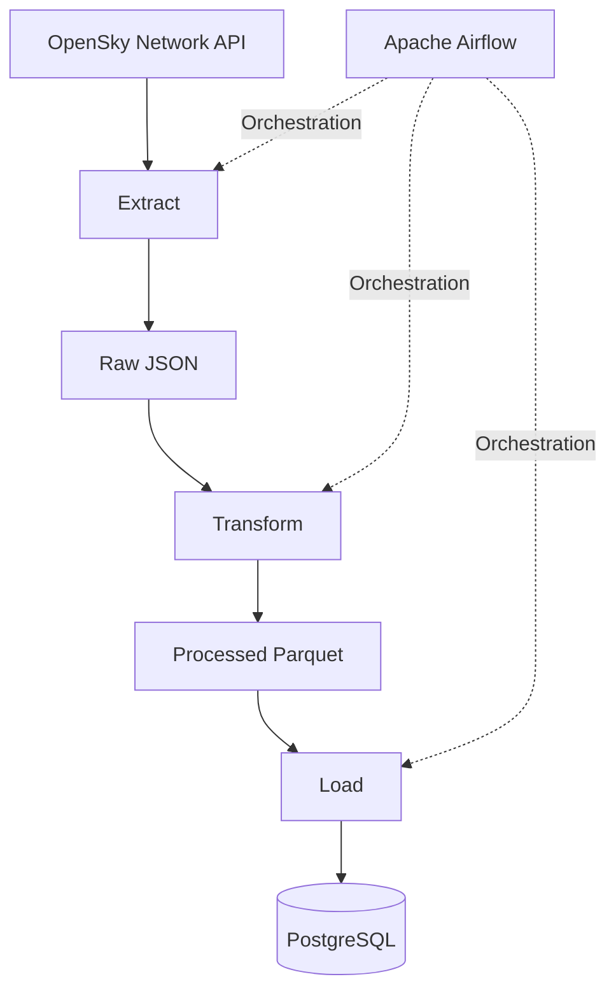

# SkyTrace ✈️

### Flight Data Engineering Pipeline

An end-to-end data engineering pipeline that collects aircraft state data from the OpenSky Network API, processes and validates the data, stores it in Parquet format, and loads it into PostgreSQL, with Apache Airflow orchestrating the workflow.

---

## Project Overview

SkyTrace is a data engineering project designed to build an automated pipeline for collecting and processing flight tracking data.

The pipeline retrieves aircraft state vectors from the OpenSky Network API, transforms the raw data into a structured format, stores intermediate datasets as Parquet files, and loads the processed data into PostgreSQL for querying and analysis.

Apache Airflow is used to orchestrate and automate the Extract, Transform, and Load (ETL) workflow.

## Architecture



## Pipeline Workflow

### 1. Extract

- Retrieves aircraft state vector data from the OpenSky Network API.
- Collects aircraft metadata and flight state information.
- Saves raw API responses as timestamped JSON files.

### 2. Transform

- Converts raw JSON state vectors into structured tabular data using Pandas.
- Handles missing values and data type conversions.
- Converts timestamps into UTC-based datetime values.
- Cleans aircraft callsigns.
- Adds pipeline metadata such as snapshot timestamp and source filename.
- Exports the transformed dataset to Parquet using Snappy compression.

### 3. Load

- Reads processed Parquet datasets.
- Validates required columns.
- Loads data into PostgreSQL using bulk COPY operations.
- Uses a staging table to support bulk loading.
- Prevents duplicate records through a composite key and conflict handling.

### 4. Orchestration

Apache Airflow manages the pipeline execution and task dependencies.

The DAG executes the following tasks sequentially:

`Extract → Transform → Load`

The pipeline is configured to run every 30 minutes.

---

## Technology Stack

| Technology | Purpose |
|---|---|
| Python | Pipeline development |
| OpenSky Network API | Aircraft data source |
| Pandas | Data processing and transformation |
| Parquet | Intermediate columnar storage |
| Snappy | Parquet compression |
| PostgreSQL | Target database |
| Apache Airflow | Workflow orchestration |
| Git | Version control |

---

## Project Structure

```text
SkyTrace-Pipeline/
│
├── data/
│   ├── raw/
│   └── processed/
│
├── docs/
│   ├── 01_project-overview.md
│   ├── 02-environment-setup.md
│   ├── 03-data-source.md
│   ├── 04-etl-pipeline.md
│   ├── 05-database-design.md
│   ├── 06-data-validation.md
│   └── 07-airflow-setup.md
│
├── notebooks/
│   └── 01_dataset_validation.ipynb
│
├── src/
│   ├── extract.py
│   ├── transform.py
│   ├── load.py
│   └── duplicate_check.py
│
├── logs/
├── .gitignore
└── README.md
```

## Data Storage

The pipeline uses separate storage layers for raw and processed data.

| Layer | Format | Description |
|---|---|---|
| Raw | JSON | Original API responses |
| Processed | Parquet | Transformed, structured, compressed datasets |
| Target | PostgreSQL | Queryable and persistent analytical data |

Parquet provides columnar storage and compression, making it suitable for efficient intermediate data storage and analytical workloads.

## Database

Processed aircraft state data is stored in PostgreSQL.

**Database:** `opensky_db`  
**Schema:** `opensky`  
**Table:** `aircraft_states`

The target table uses a composite primary key:

`(icao24, snapshot_time)`

This allows aircraft observations from different snapshots to be stored while preventing duplicate observations for the same aircraft and snapshot.

## Data Validation

Dataset validation is performed using a Jupyter Notebook before ingestion.

Validation includes:

- Schema and data type inspection
- Missing value analysis
- Duplicate record detection
- Timestamp validation
- Geographic coordinate validation
- Dataset distribution analysis

## Documentation

Detailed project documentation is available in the `docs/` directory:

- [Project Overview](docs/01_project-overview.md)
- [Environment Setup](docs/02-environment-setup.md)
- [Data Source](docs/03-data-source.md)
- [ETL Pipeline](docs/04-etl-pipeline.md)
- [Database Design](docs/05-database-design.md)
- [Data Validation](docs/06-data-validation.md)
- [Airflow Setup](docs/07-airflow-setup.md)

## Future Improvements

- Improve logging and monitoring.
- Implement retry mechanisms and failure notifications.
- Expand data quality checks.
- Explore additional aviation data sources.
- Develop analytical queries and dashboards.

---

**Built as a hands-on Data Engineering project.**
